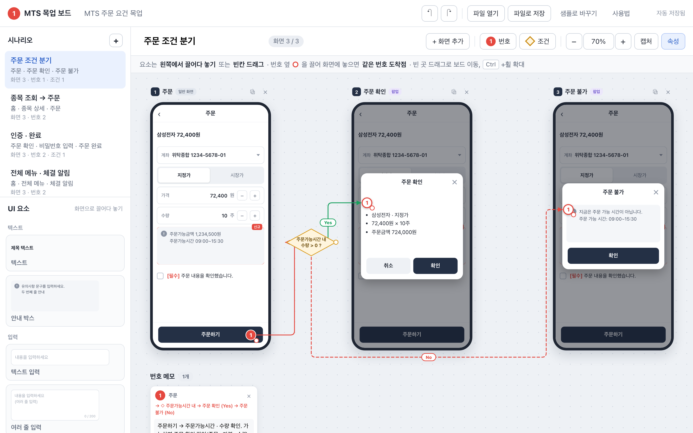
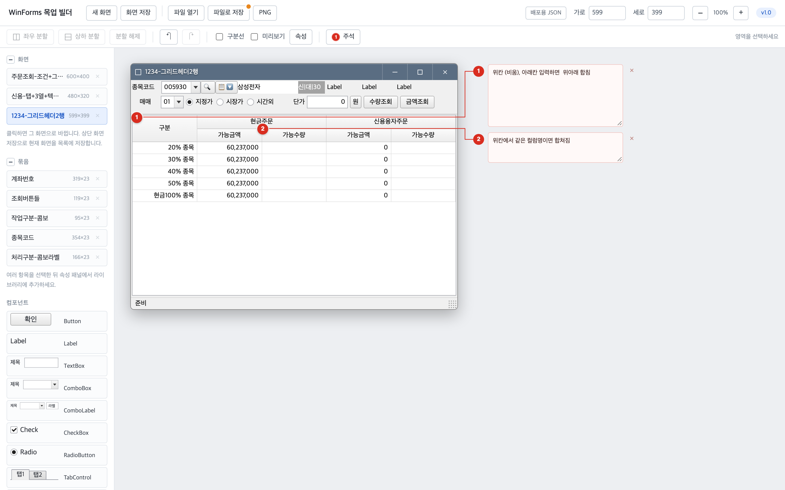
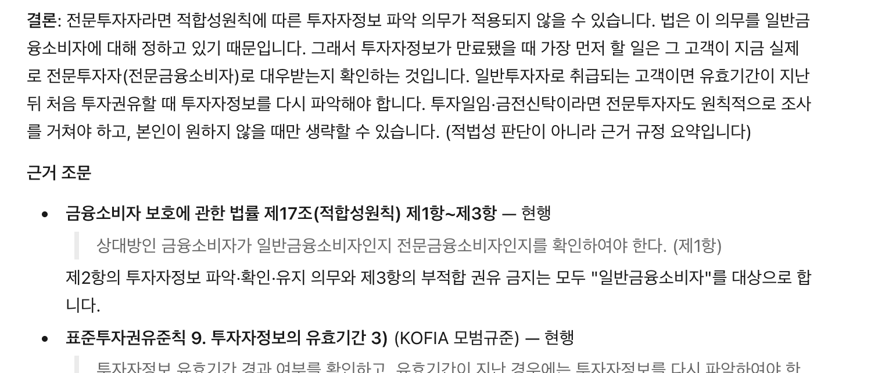
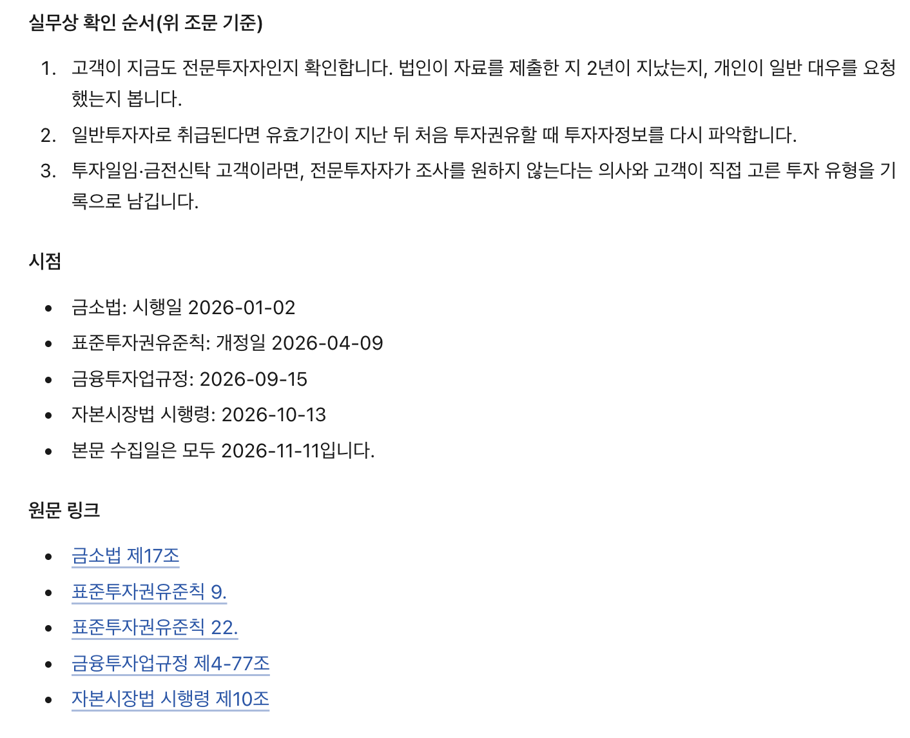

AI를 쓰고 난 이후 상당히 많은 것들을 만들었다. 
개인적으로 쓰는 것들도 있지만 (블로그 글들..) 
회사에서 업무 보조하는 툴도 상당수 만들었다. 

## MTS 목업 빌더

증권사에서 현업들은 요건서를 작성하는데, 제도와 규정 등을 담당하는 현업들은
사실 전문 디자인 툴 다룰줄 모르거나 필요없기도 하다. 
그래서 목업 툴을 만들었다. 

**"목업(mockup)은 주로 실제 기능을 구현하지 않고, 제품·화면·디자인의 시각적 형태나 구조를 보여주기 위해 만든 정적 모형 또는 시안이다."**

[https://mock-mockmts.vercel.app](https://mock-mockmts.vercel.app)



* 회사의 디자인 시스템이 별도로 있으니까, 일반적으로 통용되는 요소들을 넣었다.
* UI/UX 내용이 아니니까 디테일이 있는 요소(차트 등..)는 생략된다.
* 화면에 격자영역 (4x10)에서 원하는 부분을 마우스로 드래그 선택해서 채워넣는 방식이다.
* 요건등을 번호로 주석을 달아서 표현할수 있다.

만들어서 요건서에 첨부할때 더 정확한 내용이 담기게 된다. (더 예쁜? )
그냥 네모도형으로만 요건쓰다가 보면 좀더 깔끔하게 쓸수 있을것 같다. 
이것조차 좀 어려워하면 어쩔수 없고...


## WinForms 목업 빌더

현업은 HTS 및 회사 업무화면등에서도 쓰는 목업툴도 만들었다. 

사실 이걸 먼저 만들었다. 
만든 계기는... 엑셀로 한땀한땀 정교한 화면을 그려내는것을 보고 경악해서 🫣



## 규정 검색 스킬

여기에 공유할 순 없지만 이는 클로드 스킬이다. 
현업에게 스킬 방법을 알려주니까 오히려 더 고도로 활용을 잘 하고 있다. 😁

금투협, KRX, 법제처 등이 소스고 
금융회사(증권사)가 준수해야할 어떤 포인트를 그냥 물어봤을때 
다른 곳 검색 없이 딱 위 3군데의 소스만 가지고 찾아서
연관있다고 생각하는 법령 및 조문  그리고 얼마나 최신인지 요약해준다. 

**판단은 하지 않고 근거자료만 찾는다**

```txt
"전문투자자에 대해서 투자자정보 만료되었을때 주의해야할 점 알려줘"
```
출력:



그럼 아래와 같은 방식으로 처리한다. 


**🤖 Claude:** 
1. Claude가 질문의 생활어를 규정에 실제로 쓰이는 용어로 바꿔요 ("고객 몰래 매매" → `임의매매`)
2. 스크립트가 세 사이트의 규정 목록과 검색으로 후보 규정을 뽑아요.
3. 후보 조문은 헤드리스 Chrome으로 사이트에서 매번 다시 열어서 본문과 개정일을 확인해요.
4. 답변 끝에 이 경로를 이력으로 확정할지 묻고, 사람이 승인한 것만 사례로 쌓아요.



이 스킬은 현업 PC에 Python이 없어도 돌도록
Windows용 embeddable Python을 스킬 안에 통째로 넣었다.

그냥 zip 풀고 그 폴더를 프로젝트 폴더로 잡으면 끝. 바로 사용가능하다.

## Pro*C 태그기반 VSCode 확장

이건 내가 쓰기 위해서 만든것인데, 레거시 오라클 기반 대형 C/Pro*C 소스 네이게이터이다. 

[https://github.com/doongchoong/vstags](https://github.com/doongchoong/vstags)

예전에 ctags + cscope로 하던 일을 VSCode 기능으로 옮긴 것.

* 회사에선 보안으로 랭기지서버가 동작하지 않는다. 
* 서버환경의 소스를 로컬에서 개발한다. 
* Pro*C가 섞인 문법을 쓰다보면 기존 확장은 깨져버린다.

이러한 악조건 속 그동안 vscode를 못쓰고 있다가. 
초기화권을 소모하는 겸 클로드에게 시켜봤는데... 생각보다 너무 잘 만들어서 깜짝 놀랐다. 

회사코드 업무하나 3500개  심볼 16만개, 참조 200만개 

디버거도 넣고, 린터(컨벤션검사)도 넣고 하고싶은거 다 넣어놓았다. 


## DeepSeek 워커

이건 업무 도구는 아니고 Claude Code를 쓰면서 만든 것.
Claude Code에서 DeepSeek를 저렴한 워커로 부리는 플러그인이다.

[https://github.com/doongchoong/claude-deepseek-worker](https://github.com/doongchoong/claude-deepseek-worker)


<div style="width:100%; max-width:600px; margin:24px auto;">
  <svg viewBox="0 0 600 530" width="100%" role="img"
       aria-label="Claude DeepSeek Worker 구조: 사용자 → Claude → DeepSeek 도구 4개 → 결과 파일 또는 요약 보고"
       style="font-family: Pretendard, 'Noto Sans KR', sans-serif;">
    <style>
      .dw-box { fill: #f3f8fd; }
      .dw-group { fill: #fff; stroke: #e3e6e3; stroke-width: 1.5; }
      .dw-title { fill: #222; font-size: 19px; font-weight: 600; }
      .dw-code { fill: #222; font-size: 17px; font-weight: 600; font-family: ui-monospace, Menlo, Consolas, monospace; }
      .dw-sub { fill: #777; font-size: 14px; }
      .dw-arrow { stroke: #666; stroke-width: 1.6; fill: none; stroke-linecap: round; stroke-linejoin: round; }
    </style>

    <!-- 사용자 -->
    <rect class="dw-box" x="10" y="8" width="580" height="52" rx="10"/>
    <text class="dw-title" x="300" y="41" text-anchor="middle">사용자</text>

    <path class="dw-arrow" d="M300 68 V88 M294 82 L300 88 L306 82"/>

    <!-- Claude -->
    <rect class="dw-box" x="10" y="96" width="580" height="68" rx="10"/>
    <text class="dw-title" x="300" y="125" text-anchor="middle">Claude (메인 에이전트)</text>
    <text class="dw-sub" x="300" y="150" text-anchor="middle">설계 · 판단 · 원인 분석 · 최종 검수</text>

    <path class="dw-arrow" d="M300 172 V190 M294 184 L300 190 L306 184"/>
    <text class="dw-sub" x="300" y="212" text-anchor="middle">작업 위임</text>

    <!-- DeepSeek 도구 -->
    <rect class="dw-group" x="10" y="226" width="580" height="174" rx="10"/>

    <rect class="dw-box" x="22" y="238" width="272" height="70" rx="8"/>
    <text class="dw-code" x="38" y="267">deepseek_chat</text>
    <text class="dw-sub" x="38" y="292">단일 작업, 결과를 파일로</text>

    <rect class="dw-box" x="306" y="238" width="272" height="70" rx="8"/>
    <text class="dw-code" x="322" y="267">deepseek_batch</text>
    <text class="dw-sub" x="322" y="292">여러 작업을 병렬로</text>

    <rect class="dw-box" x="22" y="318" width="272" height="70" rx="8"/>
    <text class="dw-code" x="38" y="347">deepseek_agent</text>
    <text class="dw-sub" x="38" y="372">고치고 확인까지, 작은 에이전트</text>

    <rect class="dw-box" x="306" y="318" width="272" height="70" rx="8"/>
    <text class="dw-code" x="322" y="347">deepseek_research</text>
    <text class="dw-sub" x="322" y="372">웹 조사, 출처 달린 정리</text>

    <!-- 위아래 화살표 -->
    <path class="dw-arrow" d="M292 410 V436 M286 430 L292 436 L298 430"/>
    <path class="dw-arrow" d="M308 436 V410 M302 416 L308 410 L314 416"/>

    <!-- 결과 -->
    <rect class="dw-box" x="10" y="446" width="580" height="72" rx="10"/>
    <text class="dw-title" x="300" y="477" text-anchor="middle">결과 파일 또는 짧은 보고</text>
    <text class="dw-sub" x="300" y="503" text-anchor="middle">Claude 컨텍스트로는 경로와 요약만</text>
  </svg>
</div>



## 그 외

* 넥스트레이드 전문 설계서 사이트: `.xlsm`으로 나오는 표준전문 설계서를 파싱해서 정적 웹페이지로 만든다.
* 마켓메이커 봇: 호가창 시뮬레이터와 거기에 주문을 넣는 봇. 만든 과정은 [에이전트코딩](/posts/에이전트코딩/)에 정리했다.

<!-- TODO: 마무리 한두 줄 -->


## 후기

**"바퀴를 재발명하지 마라"**

프로그래밍에서 유명한 격언이다. 이미 기술/방법이 있는데도 
일부러 무시하고 다시 만드는 행위를 말하며 
거의 금기시 되다시피 하는 내용이였는데. 

AI가 코딩 속도가 더 빠르고 정확하게 프로그램을 만드는 이후부터는
간단하게 사용할 수 있는 툴은  그냥 즉석에서 만들어 쓸수 있게 되었다. 
이제는 

**"간단한건 그냥 만들어 써라"**

이렇게 되는게 아닐까? 

